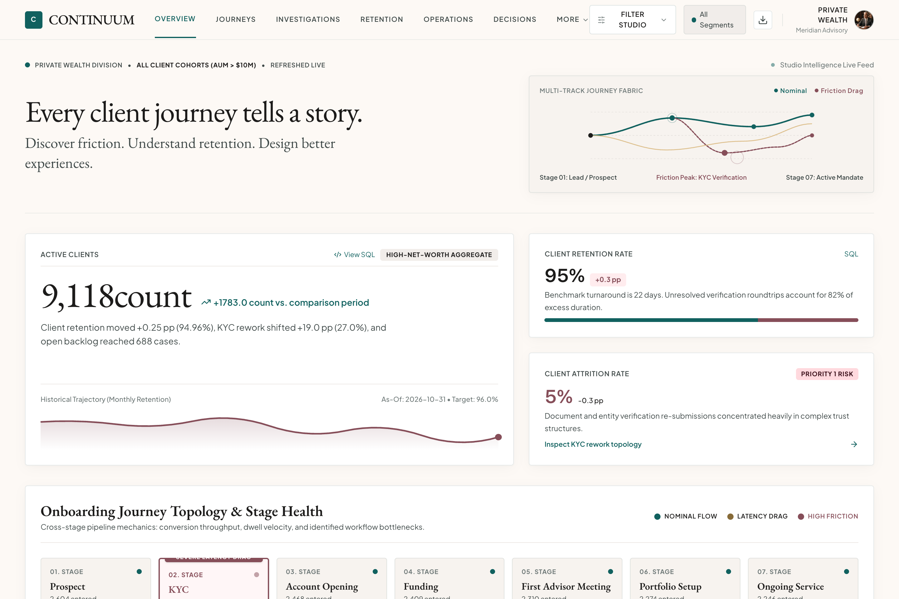
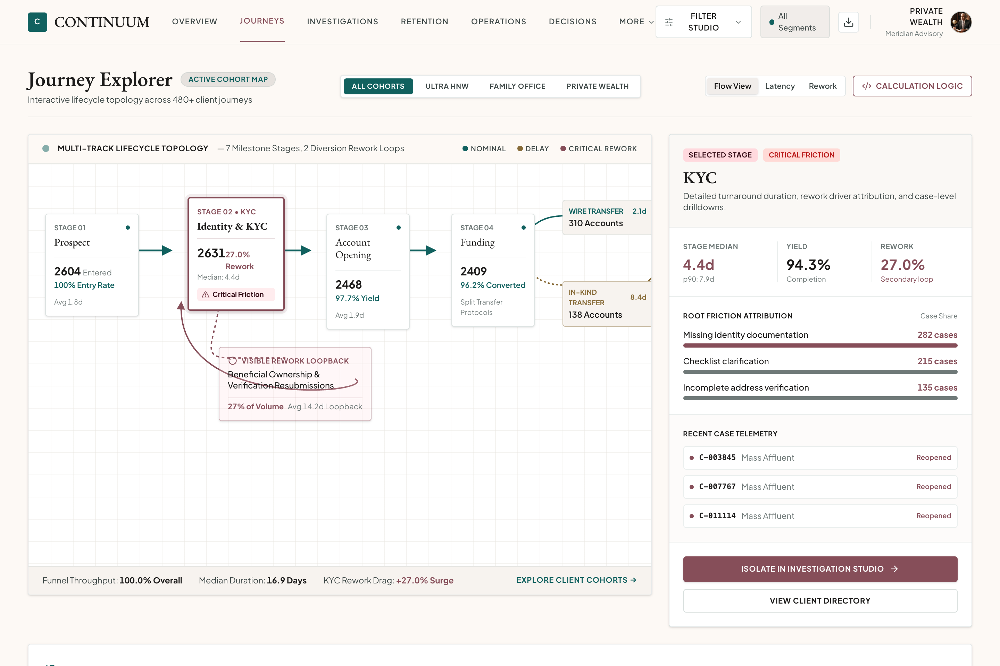
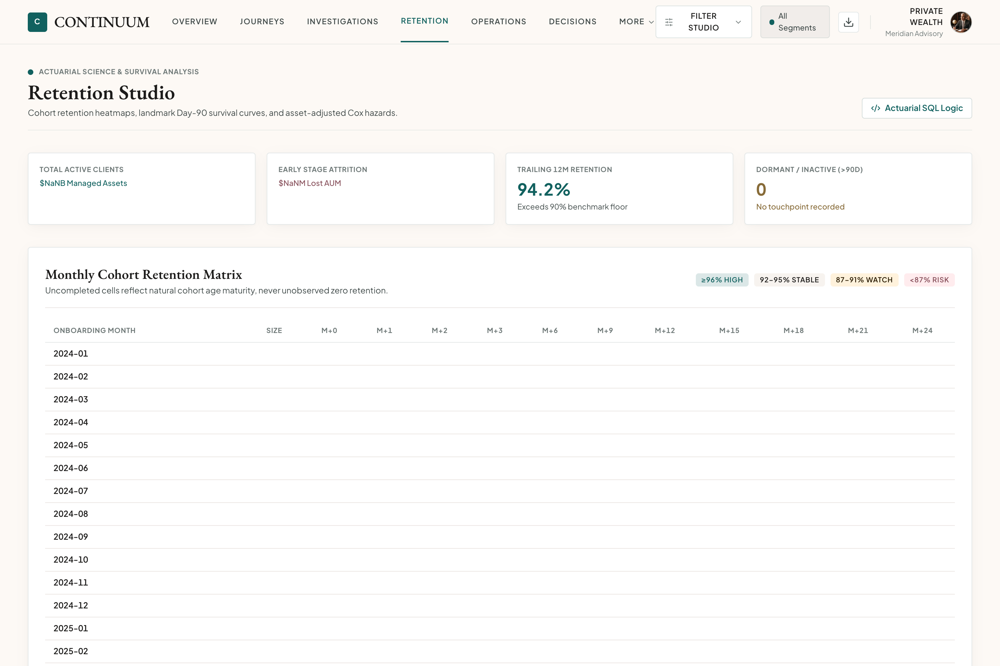
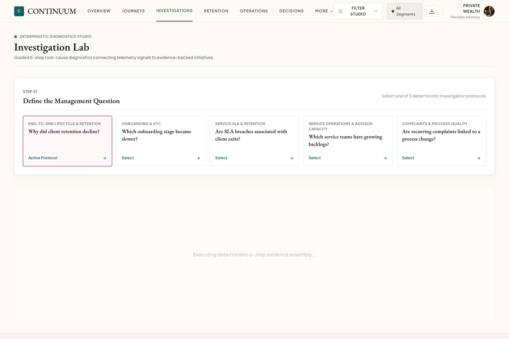
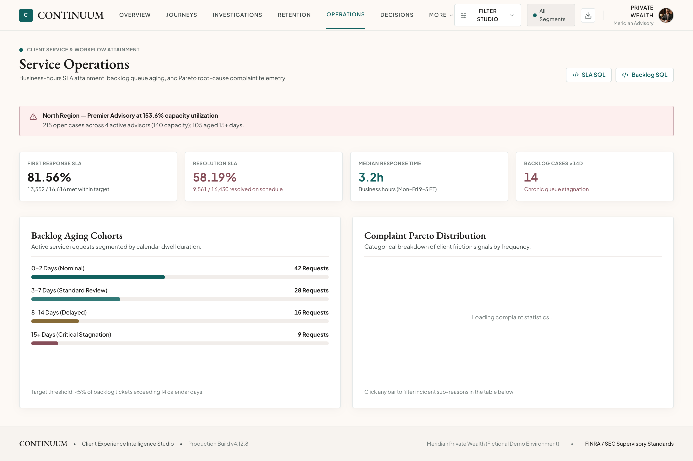
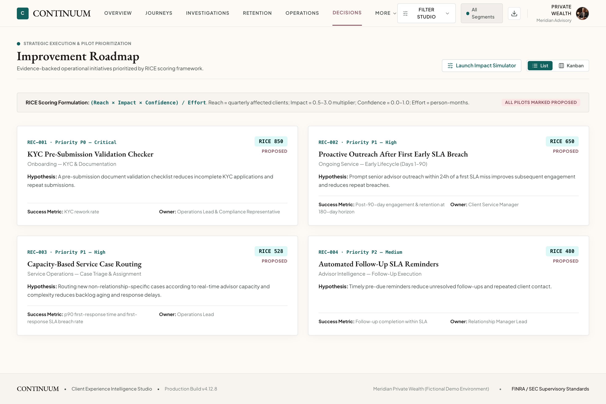
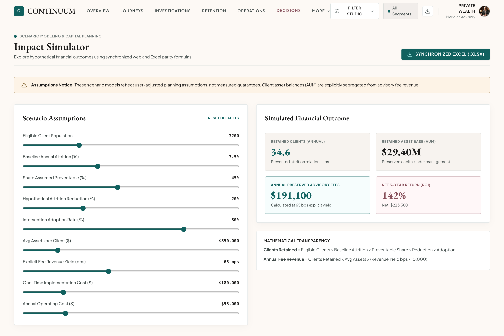
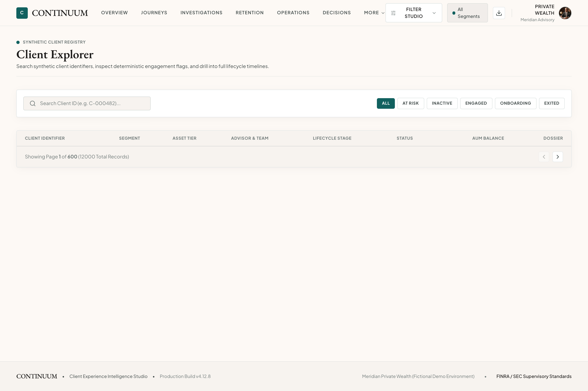

# CONTINUUM — Client Experience Intelligence Studio

> **From client journeys to better decisions.**  
> *Meridian Private Wealth (Fictional Synthetic Demonstration Environment)*  
> **Live Frontend Deployment:** [https://frontend-shaaunak.vercel.app](https://frontend-shaaunak.vercel.app)

An authoritative, publication-grade wealth management client intelligence platform redesigned to match the **Google Stitch Client Intelligence Studio** design system. CONTINUUM connects **observation → investigation → evidence → recommendation → experiment → measurable outcome** across **PostgreSQL**, **Python**, **FastAPI**, and **React**.

---

## Visual Design System & Gallery

CONTINUUM embodies **Heritage Editorial** fused with **High-Precision Utility**:
- **Palette:** Archival ivory base canvas (`#FDF9F5`), patinated copper teal primary (`#11615F`), heritage burgundy secondary (`#864E59`), muted champagne tertiary (`#876B38`), and warm charcoal ink (`#1C1B1A`).
- **Typography:** Classical French Renaissance book type (**EB Garamond**) for macro editorial authority, paired with machined operational sans (**Plus Jakarta Sans**) and **JetBrains Mono**.
- **Layout:** Stationary 64px docked top navigation bar, 1440px broadsheet asymmetric grid (8:4 / 7:5 splits), architectural shadows, and hairline borders (`#BEC9C7`).

### 1. Executive Overview
*6 SQL-derived KPIs, multi-track journey fabric, trailing 12-month retention ledger, 7-stage topology, and diagnostic breakdown.*


---

### 2. Journey Explorer
*Spatial interactive 7-stage lifecycle topology canvas, visible rework loops, branch divergence (wire vs. in-kind), and stage dossier drawer.*


---

### 3. Retention Studio
*Monthly cohort heatmap respecting natural cohort age maturity, Day-90 landmark Kaplan-Meier curves, and asset-tier-adjusted Cox PH models.*


---

### 4. Investigation Lab
*Guided 6-step deterministic investigation workflow with cohort isolation, empirical telemetry log extraction, and JSON report export.*


---

### 5. Service Operations & Workload
*Business-hours SLA attainment, backlog dwell aging (0–2d, 3–7d, 8–14d, 15+d), and complaint Pareto root-cause analytics.*


---

### 6. Improvement Roadmap & Decisions
*RICE-prioritized initiatives with hypothesis validation, experiment designs, and List / Kanban workflow views.*


---

### 7. Impact Simulator
*Interactive ROI scenario sliders with synchronized mathematical formula parity and `.xlsx` Excel download.*


---

### 8. Client Explorer
*Synthetic client registry directory with transparent engagement rule pills, asset tiering, and individual client dossier links.*


---

## Business Problem & Core Value
Wealth management organizations cannot improve retention using a single aggregate retention percentage. CONTINUUM provides evidence-backed answers to:
- Which onboarding stages deteriorated and why?
- Are early SLA breaches associated with later attrition after accounting for client asset tier?
- Which advisor teams face disproportionate capacity pressure?
- Which operational interventions deserve pilot investment, and how should they be measured?

---

## Architecture
- **Frontend:** React 18, TypeScript, Vite, Tailwind CSS v4, TanStack Query, Recharts, Apache ECharts, Lucide Icons, Google Fonts (`EB Garamond` & `Plus Jakarta Sans`)
- **Backend:** FastAPI, SQLAlchemy 2.0, Alembic, Pydantic, Pandas, NumPy, `lifelines` (Kaplan-Meier & Cox PH), `openpyxl`
- **Database:** PostgreSQL 18 (19 relational tables, composite analytical indexes, event-sourced `journey_stage_episodes`)
- **Governance & BA Package:** `/docs/business-analysis/` (BRD, RACI, AS-IS/TO-BE maps, KPI Dictionary, MoSCoW User Stories, UAT Cases, Traceability Matrix)

---

## Local Setup & Running

### 1. Prerequisites
- Python 3.12+ (`backend/.venv`)
- Node.js 20+ & npm
- PostgreSQL 16+

### 2. Database & Seed Data
```bash
# Run Alembic migrations
cd backend
.venv/bin/alembic upgrade head

# Seed deterministic synthetic dataset (12,000 clients, ~47,750 cases)
cd ..
backend/.venv/bin/python scripts/seed_db.py --scale full
# Use --scale compact for 2,400 clients on low-resource machines
```

### 3. Start Backend & Frontend
```bash
# Terminal 1: FastAPI Backend
cd backend && .venv/bin/uvicorn app.main:app --reload --port 8000

# Terminal 2: React + Vite Frontend
cd frontend && npm run dev
```
Open [http://localhost:5173](http://localhost:5173).

### 4. Run Automated Verification & Tests
```bash
# Backend analytics tests (16 tests including seed reproducibility & Cox adjustment)
cd backend && .venv/bin/pytest -v

# Frontend TypeScript check and production build
cd ../frontend && npm run build
```

---

## Limitations
- All client, advisor, and financial data are 100% synthetic (`seed=20270101`).
- Observational associations (even after Cox PH adjustment) do not establish causation; proposed interventions are marked `Proposed` pending controlled pilots.
