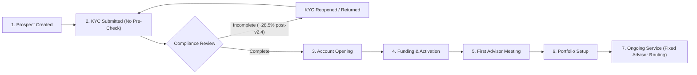

# 03 — AS-IS Onboarding & Service Process

## Current State Summary
Following the introduction of **Enhanced KYC Documentation Checklist v2.4 (`PC-001`, effective 2026-04-01)** and the **North Region T-03 Staffing Reduction (`PC-002`, effective 2026-05-15)**, the current workflow exhibits two major friction loops:
1. **Unvalidated KYC Submissions:** Clients and advisors submit KYC packages without automated completeness checks, causing Compliance to return ~28.5% of post-April 2026 applications (`Reopened` stage episodes) for `Missing identity documentation` or `Checklist clarification`.
2. **Unbalanced Service Routing:** New service cases route strictly to the assigned advisor without real-time capacity checks, pushing `T-03` utilization above 100% and increasing aged backlog (`15+ days`).

