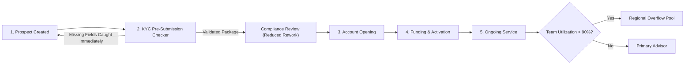

# 04 — TO-BE Proposed Process

## Target State Summary
The proposed **TO-BE** workflow addresses the two validated bottlenecks through testable operational pilots:
1. **KYC Pre-Submission Validation Checker (`REC-001`):** Interactive completeness validation at point of entry prevents missing ID and checklist v2.4 omissions before entering the Compliance queue.
2. **Capacity-Based Overflow Routing & Proactive Breach Outreach (`REC-003`, `REC-002`):** When a team's active utilization exceeds 90%, eligible Low/Medium complexity cases overflow to regional backup pools, and any early-tenure (<90d) SLA breach triggers a mandatory 24h Client Service Manager outreach task.

